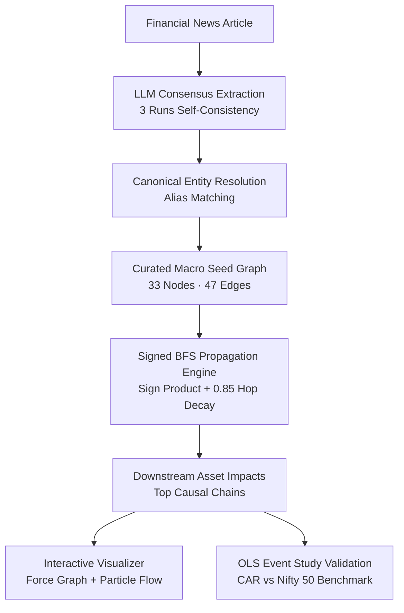

# Market Impact Graph (HackWave 3.0 · PS5)

> **Explainable causal propagation for the Indian economy and financial markets.**  
> Takes unstructured financial news, extracts real-world events, and propagates their impact through a curated macroeconomic causal graph. Distinguishes observed facts from inferred relationships with transparent confidence bounds and epistemic uncertainty.

---

## 🏆 Core Design Principles (Strict Adherence to PS5)

1. **LLMs Extract Facts, Not Graphs**: The LLM is used **strictly** to extract the event type, primary entity, direction, magnitude, region, and evidence sentence from raw news. It is **never** permitted to hallucinate or invent causal relationships.
2. **Curated Macro Seed Graph**: All propagation runs on a validated directed graph representing the Indian economy (**33 nodes, 47 edges**) grounded in peer-reviewed economic research, RBI working papers, and IEA market models.
3. **Signed, Decayed BFS Propagation**: Edge signs follow formal arithmetic (`+`, `−`, `?`), decaying by $0.85^{\text{hops}-1}$ with cycle prevention.
4. **Self-Consistency Consensus**: 3 independent LLM runs calculate entity agreement ratios without relying on hallucinated confidence numbers.
5. **Empirical Event Study Validation**: Optional historical cross-check via an OLS market model against Nifty 50 (`^NSEI`) benchmark to compute Cumulative Abnormal Return (CAR).
6. **Epistemic Uncertainty & Humility**: Transparently marks real-world friction (RBI FX reserve intervention, government excise duty freezes). **Never presents outputs as guaranteed financial forecasts.**

---

## 🏗️ Architecture & Pipeline



### Curated Seed Graph Themes
- **Theme 1: Energy & Crude Shocks**: OPEC+ Cuts / Crude Oil $\to$ Aviation Turbine Fuel (ATF) $\to$ Airlines (IndiGo) & Oil Marketing Companies (OMCs) & Paints.
- **Theme 2: Inflation & Rates**: CPI Inflation $\to$ RBI Rate Expectations $\to$ Repo Rate $\to$ G-Sec Yields.
- **Theme 3: Policy Transmission**: Repo Rate $\to$ Net Interest Margins (Nifty Bank) $\to$ EMIs & Credit Demand (Real Estate & Auto).
- **Theme 4: Forex Dynamics**: USD/INR Spot Rate $\to$ Import Bill (Crude & CAD) vs. Exporter Realization (IT & Pharma).
- **Theme 5: Global Risk Sentiment**: US Dollar Index (DXY) & Fed Rate $\to$ FPI Capital Flows $\to$ Domestic Equities.

---

## 🚀 Quickstart Guide

### 1. Prerequisites
- **Python**: 3.10+ (tested on Python 3.12)
- **Node.js**: v18+ (tested on v20+)

### 2. Backend Setup
```bash
cd backend

# Create and activate virtual environment (Windows)
python -m venv .venv
.venv\Scripts\activate

# Install dependencies
pip install -r requirements.txt
pip install pytest

# Pre-populate demo cache for instant offline evaluation (STEP 9)
python preload_demo_cache.py

# Start FastAPI server
uvicorn app.main:app --reload --port 8000
```
*Backend runs at `http://localhost:8000`. API docs available at `http://localhost:8000/docs`.*

### 3. Frontend Setup
```bash
cd frontend

# Install packages
npm install

# Start Vite development server
npm run dev
```
*Frontend runs at `http://localhost:5173`.*

---

## 🧪 Testing & Validation

### 1. Unit Tests
Run the 21 automated backend tests covering Pydantic schemas, seed graph integrity, sign arithmetic, cycle prevention, and alias matching:
```bash
cd backend
.venv\Scripts\python -m pytest tests/ -v
```
*(All 21 tests pass with 100% success).*

### 2. Historical Event Backtest (STEP 10)
Run the backtest across 10 historical Indian macroeconomic shocks (OPEC+ cuts, RBI off-cycle hikes, Fed tightening, rupee all-time lows):
```bash
cd backend
.venv\Scripts\python backtest.py
```

---

## 🎯 Benchmark Demo Scenarios

The interactive UI features 4 pre-loaded scenarios for instantaneous evaluation:

| # | Scenario | Primary Trigger | Key Propagation Channels |
|---|---|---|---|
| 1 | **OPEC+ 1.16M bpd Production Cut** | `crude_oil` (+) | CAD widens $\to$ INR weakens $\to$ OMC & Aviation margins drop $\to$ IT/Pharma export benefit. |
| 2 | **RBI 25 bps Repo Rate Hike** | `repo_rate` (+) | G-Sec yield rises $\to$ Nifty Bank NIM compresses $\to$ EMIs rise $\to$ Realty & Auto cool down. |
| 3 | **Rupee Slips to 84.50 All-Time Low** | `inr` (+) | Import inflation increases $\to$ IT exporters (TCS, Infy) & Pharma gain on USD revenues. |
| 4 | **Monsoon Deficit & Food CPI Spike (6.8%)** | `food_inflation` (+) | Headline CPI breaches 6% band $\to$ Rate cuts delayed $\to$ FMCG rural purchasing power hit. |

---

## 🛡️ Epistemic Uncertainty & Real-World Friction

Economic systems are subject to institutional buffers and policy interventions:
- **Government Excise Duty Absorption**: Fuel price caps may insulate consumers while compressing OMC retail margins.
- **RBI FX Intervention**: Utilization of India's ~$688B foreign exchange reserves buffers rapid INR depreciation.
- **Global Risk Offsets**: FPI sentiment and US 10-year yields can temporarily decouple domestic asset prices from local economic fundamentals.

All graph scores represent **plausible structural impact scenarios**, not financial recommendations.
 
---

## 🧭 Application Views & Navigation Architecture

The application interface is organized into five dedicated, synchronized views powered by a single shared analysis state:
- **`#overview` (Overview)**: Executive summary strip, live market verdict banner, 2-column workspace with a sticky live news feed, 3-column sector cards (positive, negative, mixed), mini graph & top impact chains, connection inspector, detailed causal reasoning accordions, and knowledge base status card.
- **`#graph` (Impact graph)**: Full-size interactive transmission SVG graph with minimum confidence threshold slider, comprehensive visual legend, and edge evidence inspector.
- **`#chains` (Impact chains)**: Ranked transmission pathways from trigger shock to terminal assets with mechanism steps and reach-by-type SVG donut breakdown.
- **`#assets` (Affected assets)**: Constituent equities and indices with live prices, sensitivity score bars, and real-time search filtering.
- **`#rules` (Knowledge base)**: Persistent SQLite cumulative graph with layer isolation (`curated seed` vs `news evidence` vs `both`), node type and confidence filters, corroborating article evidence, and update history.
